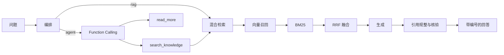

# 有据 YouJu

企业知识智能体：回答带出处，资料不够时可以拒答。

把制度、规程、手册做成可提问的智能体。关键结论后标注来源编号，没有依据就不作答。示例资料全部为演示虚构。

## 能看什么

- **引用核验**：回答里的 `[1]` 能点回原文；句子和引用片段做词面覆盖率比对，依据不足会单独标出。
- **严格模式**：检索不到足够依据时固定拒答，不拿常识补结论。
- **两种回答策略**：RAG 先检索再生成；Agent 用 Function Calling 自己决定检索词和次数。
- **知识库**：上传 md / txt / pdf / docx / html / csv / xlsx，按章节切片，向量 + BM25 混合检索，可选重排。
- **视觉检测**：按视频名称拉流，监视画面上叠检测框；可用自然语言或表单配置算法规则。告警推给安全巡检助手。
- **事件中心**：把告警、工单推过来，按规程生成带出处的处置建议，人工确认。
- **对外接口**：OpenAI 兼容的 `/v1/chat/completions`，以及 MCP（`list_knowledge_bases` / `search_knowledge` / `ask_agent`）。

没接入大模型时也能跑：直接摘录检索到的原文句子。

## 三分钟怎么演示

1. 按下面命令启动，浏览器打开 http://127.0.0.1:8000
2. 创建管理员账号，勾选导入示例数据（4 个知识库、4 个智能体、检索评测题）
3. 打开「安全巡检助手」，问：**安全带没扣好可以继续干活吗？**  
   结论应是立即停工，句后有来源编号，底部能看到引用核验
4. 再问：**明天天气怎么样？**  
   严格模式下应说明资料中没有依据，不作答
5. 切到「运维值班助手」（Agent 模式），问：**CPU 使用率一直很高怎么排查？**  
   看思考过程里的检索步骤，以及回答是否标了手册编号
6. 打开「视觉检测」，输入 **杆塔3** 点拉流：监视墙出画面和检测框，右侧出告警
7. 切到「检测规则」，用这句话配置：**给动火区拉流，检测烟火和有没有监护人，推给安全巡检助手**
8. 打开「事件中心」，点开刚推过来的视觉告警，看处置步骤是否引用规程
9. 打开某个知识库的「评测」，跑种子题，看 Hit@1 / Hit@K / MRR

接口文档在 http://127.0.0.1:8000/docs

## 启动

需要 Python 3.10+。

```bash
pip install -r requirements.txt
python -m youju
```

默认监听 http://127.0.0.1:8000 ，首次启动会打开浏览器。

接入对话模型（可选，在页面「设置 → 模型服务」里填也可以）：

```bash
# 例：DeepSeek
# 打开设置页，选 DeepSeek 预置，填入 API Key
```

还预置了通义千问、智谱、Kimi、豆包、OpenAI、Claude、Gemini、Ollama 等。本地嵌入默认是哈希向量，不调用外部接口；换成厂商 embedding / rerank 后检索会更准。

## 测试

```bash
pip install -r requirements-dev.txt
pytest
python scripts/stress.py
```

压测默认起临时库，不会改你本地的 `data/`。打正在跑的服务：

```bash
python scripts/stress.py --url http://127.0.0.1:8000 --user admin --password admin123
```

## 架构



Agent 模式最多 4 轮工具调用。最后一轮不再调工具，必须根据已有资料作答。模型调用失败时降级为离线摘录。

混合检索：召回 30 条 → RRF 融合 → 可选重排 → 按 loose / standard / strict 做依据闸门。闸门没过且开了严格模式，直接拒答。

## 目录

| 路径 | 作用 |
| --- | --- |
| `youju/agent/runner.py` | 选模式、工具循环、降级、引用核验 |
| `youju/agent/tools.py` | `search_knowledge` / `read_more` / `current_time` |
| `youju/agent/citations.py` | 引用编号规整、词面覆盖率核验 |
| `youju/rag/` | 解析、切片、索引、混合检索 |
| `youju/providers/` | OpenAI 兼容 / Anthropic / Gemini 的流式协议 |
| `youju/routers/` | 对话、知识库、智能体、视觉检测、事件、评测、MCP、OpenAI 接口 |
| `youju/vision/` | 拉流会话、规则解析、点位画面、检测适配器 |
| `youju/seed/` | 虚构规程、智能体模板、评测题、示例事件 |
| `youju/web/` | 无构建前端 |
| `tests/` | API、检索/引用、模型协议、模式降级 |

运行时数据库和上传文件在 `data/`，不进版本库。

## 和常见说法怎么对应

| 说法 | 仓库里能指给别人看的 |
| --- | --- |
| RAG | `rag/retrieve.py`：向量 + BM25 + RRF，可选 rerank |
| Function Calling Agent | `agent/runner.py` + `agent/tools.py` |
| 无依据不编造 | 检索闸门 + 严格模式拒答 + 引用核验 |
| 流式对话 | SSE：`meta` / `step` / `delta` / `sources` / `final` |
| 多模型 | `providers/presets.py`，设置页可测连通、拉模型列表 |
| MCP / OpenAI 兼容 | `routers/mcp.py`、`routers/openai_api.py` |
| 评测 | 知识库页 Hit@K / MRR，种子题在 `youju/seed/eval/` |
| 视觉检测 | `vision/`：按名称拉流、自然语言配规则、告警进事件中心 |
