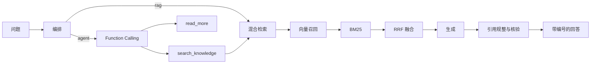

# 有据 YouJu

企业知识智能体：回答带出处，资料不够时可以拒答。

把制度、规程、手册做成可提问的智能体。关键结论后标注来源编号，没有依据就不作答。示例资料全部为演示虚构。

## 能看什么

- **引用核验**：回答里的 `[1]` 能点回原文；句子和引用片段做词面覆盖率比对，依据不足会单独标出。
- **严格模式**：检索不到足够依据时固定拒答，不拿常识补结论。
- **两种回答策略**：RAG 先检索再生成；Agent 用 Function Calling 自己决定检索词和次数。
- **知识库**：上传 md / txt / pdf / docx / html / csv / xlsx，按章节切片，向量 + BM25 混合检索，可选重排。
- **视觉检测**：演示点位按名称打开内置场景；上传的图片或视频可以预览。检测框在未配置本机 YOLO / 看图模型时是场景演示，不是摄像头识别。告警可推给安全巡检助手。
- **事件中心**：把告警、工单推过来，按规程生成带出处的处置建议，人工确认。
- **对外接口**：OpenAI 兼容的 `/v1/chat/completions`，以及 MCP（`list_knowledge_bases` / `search_knowledge` / `ask_agent`）。

没接入大模型时也能跑：直接摘录检索到的原文句子。

## 三分钟怎么演示

1. 按下面命令启动，浏览器打开 http://127.0.0.1:8000
2. 创建管理员账号，勾选导入示例数据（4 个知识库、4 个智能体、检索评测题）
3. 打开「安全巡检助手」，问：**安全带没扣好可以继续干活吗？**  
   结论应是立即停工，句后有来源编号，底部能看到引用核验
4. 再问：**明天天气怎么样？**  
   严格模式下应说明资料中没有依据，不作答
5. 切到「运维值班助手」（Agent 模式），问：**CPU 使用率一直很高怎么排查？**  
   看思考过程里的检索步骤，以及回答是否标了手册编号
6. 打开「视觉检测」，输入 **杆塔3** 点拉流：监视墙出现演示画面和检测框，右侧出告警。这不是在连接真实摄像机
7. 切到「检测规则」，用这句话配置：**给动火区拉流，检测烟火和有没有监护人，推给安全巡检助手**
8. 打开「事件中心」，点开刚推过来的视觉告警，看处置步骤是否引用规程
9. 打开某个知识库的「评测」，跑种子题，看 Hit@1 / Hit@K / MRR

接口文档在 http://127.0.0.1:8000/docs

## 启动

需要 Python 3.10+。

```bash
pip install -r requirements.txt
python -m youju
```

默认监听 http://127.0.0.1:8000 ，首次启动会打开浏览器。

接入对话模型（可选，在页面「设置 → 模型服务」里填也可以）：

```bash
# 例：DeepSeek
# 打开设置页，选 DeepSeek 预置，填入 API Key
```

还预置了通义千问、智谱、Kimi、豆包、OpenAI、Claude、Gemini、Ollama 等。本地嵌入默认是哈希向量，不调用外部接口。换成厂商 embedding / rerank 后需要自己再跑评测；仓库里的基线没有把这种替换写成已经更快或更准。

## 测试

```bash
pip install -r requirements-dev.txt
pytest
python scripts/stress.py
python scripts/diag_baseline.py --compare-strict
```

`diag_baseline.py` 只用临时库和仿真规程。不加 `--embedding-ref` 时不会调用真实 embedding 或 rerank。

压测默认起临时库，不会改你本地的 `data/`。打正在跑的服务：

```bash
python scripts/stress.py --url http://127.0.0.1:8000 --user admin --password admin123
```

## 能力边界

**已经实现**

- 文档上传、解析、切片，以及哈希向量 + BM25 + RRF。接上厂商的 embedding / rerank 后才会调用外部向量接口。
- 回答中的来源编号、词面覆盖率核验，以及检索依据不足时的严格拒答。核验比较的是用词重叠，不是事实蕴含。
- RAG，以及带 `search_knowledge` / `read_more` / `current_time` 的 Function Calling。外部 MCP 只有用户自己接上之后才会出现。
- 登录、成员、HttpOnly 会话和 API Key。知识库要给同事用，需要把该库设为团队可见；只把智能体设为团队可见，不会把创建者的私有库一并授出。
- OpenAI 兼容接口和 MCP 服务端，调用时沿用这把密钥对应用户的知识库权限。
- 视觉文件只从该用户自己的上传目录读取，并拒绝路径穿越和符号链接逃出。全局视觉模型配置只有管理员能改。
- 仿真排障闭环：网页创建或导入故障记录，绑定有权阅读的知识库后做离线诊断，生成待审变更单，人工记下回归结果，并导出 Markdown。权限撤销后，旧引用不再返回原文。

**仿真，不是已接入的视频平台**

- 种子点位（杆塔3、动火区等）是 `demo://` 场景。画面和检测框由程序按场景画出来，不拉真实视频流，也不连接录像机或设备网。
- 「排障闭环」里的断流、对讲、版本不匹配和依据不足都是虚构样例。日志是页面上的文本，不是终端上报。
- 变更单的「通过」只记录本地点击，不执行命令，不改文件，也不代表外部审批。
- 回归「通过」只在每条验证项都被人工记为 pass 时出现。未记录或未测不会写成通过。
- 示例制度、评测题和示例事件都是虚构内容。
- 未安装本机 YOLO、也没有配置看图模型时，小模型不会根据像素得出告警。

**尚未实现**

- 不连接真实摄像机、对讲终端、设备网或生产环境。
- 不自动执行修复，也不跑 shell。
- 默认评测没有真实 embedding / rerank 对照。传入 `--embedding-ref` 也只说明临时库不能代发请求，不会编造时延。
- 没有 GraphRAG、多 Agent 编排或另一套向量库。

## 五分钟看排障闭环

1. `pip install -r requirements.txt` 然后 `python -m youju`，打开 http://127.0.0.1:8000
2. 创建账号。侧栏进入「排障闭环」，点「导入仿真样例」
3. 打开「仿真：视频断流」，点「生成诊断」。应看到规程摘录、文件名、章节和 chunk 编号
4. 打开「仿真：依据不足」。页面上应有显著的「非结论」，证据列表为空
5. 回到断流记录，在变更单上点「通过审核」。这只写入审核人和时间
6. 把验证项先留空再导出：Markdown 里不会出现「回归通过」。逐项记为通过后再导出，才会出现这句，并标明人工录入
7. 另开终端跑 `python scripts/diag_baseline.py --compare-strict`，看带分母的命中、闸门、拒答和词面核验

本次离线基线（哈希向量 + BM25，7 道带标签的仿真题）：文件命中 6/6，片段命中 3/3，证据闸门 6/7，拒答判断 5/6，词面核验 5/5。同义改写能排到《视频断流处置》，但覆盖率约 13%，低于标准闸门 34%，所以拒答。这是测出来的缺口，不是已经补上的召回。strict 闸门的证据判断是 5/7。检索耗时约 2 ms，只说明这 7 题在临时库上的本地耗时。

## 架构



Agent 模式最多 4 轮工具调用。最后一轮不再调工具，必须根据已有资料作答。模型调用失败时降级为离线摘录。

混合检索：召回 30 条 → RRF 融合 → 可选重排 → 按 loose / standard / strict 做依据闸门。闸门没过且开了严格模式，直接拒答。

## 目录

| 路径 | 作用 |
| --- | --- |
| `youju/agent/runner.py` | 选模式、工具循环、降级、引用核验 |
| `youju/agent/tools.py` | `search_knowledge` / `read_more` / `current_time` |
| `youju/agent/citations.py` | 引用编号规整、词面覆盖率核验 |
| `youju/rag/` | 解析、切片、索引、混合检索 |
| `youju/providers/` | OpenAI 兼容 / Anthropic / Gemini 的流式协议 |
| `youju/routers/` | 对话、知识库、智能体、视觉检测、事件、排障闭环、评测、MCP、OpenAI 接口 |
| `youju/faults.py` | 仿真诊断、变更单、回归结论和引用撤权 |
| `scripts/diag_baseline.py` | 离线评测基线，默认不调用外部模型 |
| `youju/vision/` | 演示场景、上传预览、规则解析、可选的本机检测 |
| `youju/seed/` | 虚构规程、智能体模板、评测题、示例事件 |
| `youju/web/` | 无构建前端 |
| `tests/` | API、检索/引用、模型协议、模式降级 |

运行时数据库和上传文件在 `data/`，不进版本库。

## 和常见说法怎么对应

| 说法 | 仓库里能指给别人看的 |
| --- | --- |
| RAG | `rag/retrieve.py`：向量 + BM25 + RRF，可选 rerank |
| Function Calling Agent | `agent/runner.py` + `agent/tools.py` |
| 无依据不编造 | 检索闸门 + 严格模式拒答 + 引用核验 |
| 流式对话 | SSE：`meta` / `step` / `delta` / `sources` / `final` |
| 多模型 | `providers/presets.py`，设置页可测连通、拉模型列表 |
| MCP / OpenAI 兼容 | `routers/mcp.py`、`routers/openai_api.py` |
| 评测 | 知识库页 Hit@K / MRR，种子题在 `youju/seed/eval/` |
| 视觉检测 | `vision/`：演示场景或上传文件、自然语言配规则、告警进事件中心 |
